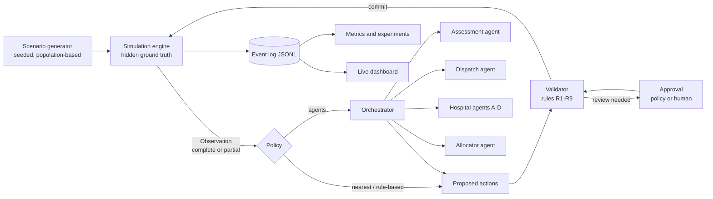

# ORCA-EMS

**Orchestrated Response and Capacity Allocation.** Multi-agent negotiation for
ambulance-to-hospital coordination, in a reproducible simulation.

Ambulances are often sent to the nearest emergency department even when it is overcrowded.
Crews then wait at the door to hand over patients, and their ambulance cannot take the next
call. In a mass-casualty event one hospital floods while others still have room. ORCA-EMS
simulates a town's EMS system in which AI agents (an assessor, a dispatcher, one agent per
hospital, and an allocator) share status and negotiate where each patient goes. Hard safety
rules and human approval sit on top.

**Research question:** when does negotiation between AI agents improve emergency resource
coordination, and when are deterministic rules good enough?

> This is a simulation study with synthetic patients. It makes no clinical claims.

## Architecture



- The **engine** is the only source of truth. Policies propose; the engine validates and
  commits. Agents never see hidden truth or change state directly.
- The **validator** enforces nine hard rules. Examples: a critical patient rides alone;
  critical trauma goes to a trauma center; no ambulance enters an unsecured violent scene;
  private contracts and nurse coverage are respected; agents cannot change capacity.
- Risky decisions (rule R6, or an agent's low confidence) wait for **approval**, the same way
  for baselines and agents.
- **Agents** use the OpenAI Agents SDK with typed outputs and read-only tools. Their responses
  are cached, so any run replays exactly.

## Setup

```bash
uv venv --python 3.11 .venv
uv pip install --python .venv/bin/python -r requirements.txt
cp .env.example .env    # add OPENAI_API_KEY and OPENAI_MODEL for real agent runs
```

Python 3.11. Without an API key everything except live LLM calls works. The dashboard can then
run the agents with an offline stand-in, which is clearly labeled and is not an LLM.

## One-command runs

```bash
.venv/bin/streamlit run app/streamlit_app.py     # live dispatch dashboard
.venv/bin/python run.py --policy rule_based --demand surge --info partial --seed 7
.venv/bin/python run.py --policy agents --preset "School bus crash"   # needs .env
.venv/bin/python eval/run_experiments.py --seeds 5                    # results/summary.md
.venv/bin/python -m sim.generator --seed 7 --demand surge             # write a scenario
.venv/bin/pytest && .venv/bin/ruff check .
```

**Dashboard.** Pick an incident (cardiac arrest, two-car crash, shooting, school bus crash,
bus crash plus shooting, normal day) and who decides. Then press Start and watch:

- the incident table with triage counts
- the town map
- the conversation between caller, dispatch, ambulances, hospitals and safety rules
- the hospital status board, the ambulance board, the mass-casualty board, and handling times

Every message carries a label saying who produced it: the real AI agent, the rule backup, the
offline stand-in, or the simulation. The **AI activity** tab lists each model call with exactly
what the agent was given and what it answered.

To replay a run, write a log with `run.py` (add `--save` for a transcript and scorecard in
`results/runs_saved/`) and open it via **Advanced → Replay a saved run**.

**No API key?** The saved agent answers in `data/llm_cache/` are committed. With
`LLM_MODE=cache_only` and `OPENAI_MODEL=gpt-4o-mini` in `.env`, the dashboard replays the
Cardiac arrest, Shooting and School bus crash incidents with the real agents' answers, and
`eval/run_experiments.py --seeds 5` reproduces `results/summary.md`, all without network calls.

**Results (5 seeds, gpt-4o-mini).** With incomplete hospital information on a normal day, the
agents got every critical patient into care within 60 minutes (both baselines: none). In a
mass-casualty surge they match the baselines on deaths but send the first ambulance later.
Details, including where agents did not help, are in [docs/REPORT.md](docs/REPORT.md) §5.

**Experiments.** Four policies (`nearest`, `rule_based`, `agents_no_negotiation`, `agents`)
× 2 information settings × 2 demand levels × N seeds, on identical scenarios. LLM runs need
`LLM_MODE=record` (or `live`) and a key. Afterwards, `LLM_MODE=cache_only` replays them for
free. `--backend scripted` runs an offline dry run into `results/scripted/`. Those agent
numbers are not LLM results.

## The simulated town

Default: 50,000 people on a fictional 20 × 20 km grid. Resources derive from U.S. per-capita
figures (staffed beds 2.28, physicians 2.55, nurses 12.4 per 1,000). The steps to on-duty
staff are labeled assumptions. That gives 4 hospitals with 114 ward beds, 22 ER beds and
2 trauma surgical teams, plus 4 city and 2 private ambulances. See
[ASSUMPTIONS.md](ASSUMPTIONS.md).

## Repository

| Path | What |
|---|---|
| `sim/` | engine, hospital model (ER, wards, boarding), travel, outcomes, validator, generator, presets, observations, monitor, calibration |
| `orca_agents/` | agent models, prompts, tools, LLM cache, orchestrator, confidence gate, scripted stand-in |
| `baselines/` | nearest hospital, rule-based |
| `protocol/` | message schema |
| `eval/` | metrics, handling times, experiment grid, report tables |
| `app/` | Streamlit dashboard |
| `docs/` | report, future work, review notes |

`PLAN.md` is the build plan and `PROGRESS.md` the log of decisions. The agent package is
`orca_agents/` because the SDK itself imports as `agents`.
